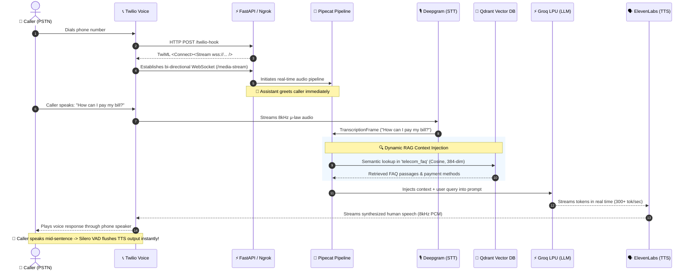
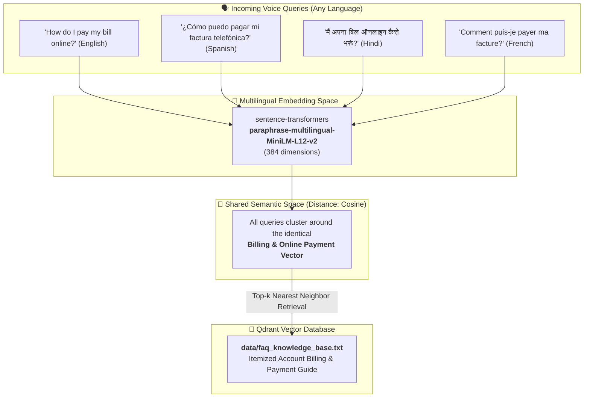

<div align="center">

# 🎙️ EchoRAG / VoiceRAG Telephony
### Real-Time Multilingual Voice AI Telephony Agent with Sub-Second RAG

[](https://www.python.org/)
[](https://fastapi.tiangolo.com)
[](https://pipecat.ai)
[](https://deepgram.com)
[](https://groq.com)
[](https://elevenlabs.io)
[](https://qdrant.tech)
[](https://opensource.org/licenses/MIT)

<p align="center">
  <b>A production-grade, full-duplex conversational voice agent that answers telephone calls, retrieves proprietary knowledge across multiple languages, and provides human-like responses with zero noticeable latency.</b>
</p>

[Key Features](#-key-features) • [System Architecture](#-system-architecture) • [Cross-Lingual RAG](#-cross-lingual-rag-engine) • [Project Structure](#-project-structure) • [Quickstart](#-quickstart-guide) • [Telephony Setup](#-telephony-integration-twilio)

---

</div>

## 🌟 Key Features

<table>
  <tr>
    <td width="50%">
      <h3>⚡ Ultra-Low Latency Pipeline</h3>
      <p>Powered by <b>Groq LPU</b> inference and streaming audio WebSockets via <b>Pipecat</b>, delivering sub-300ms Time-To-First-Byte (TTFB) so conversations feel natural without awkward pauses.</p>
    </td>
    <td width="50%">
      <h3>🌍 $0 Cross-Lingual Alignment</h3>
      <p>Uses <code>paraphrase-multilingual-MiniLM-L12-v2</code> embeddings. Callers can ask questions in <b>Spanish, Hindi, or French</b>, which map seamlessly to English vector assets in <b>Qdrant</b>.</p>
    </td>
  </tr>
  <tr>
    <td width="50%">
      <h3>🛑 Real-Time Voice Activity Detection (VAD)</h3>
      <p>Integrated with <b>Silero VAD</b>. If the caller interrupts the AI while it's speaking, audio playback is instantly flushed and cancelled, mimicking human phone manners.</p>
    </td>
    <td width="50%">
      <h3>📞 Full Telephony Integration</h3>
      <p>Connects directly to real telephone networks (PSTN) via <b>Twilio Media Streams</b> and automated <b>ngrok</b> tunneling with zero complex infrastructure.</p>
    </td>
  </tr>
</table>

---

## 🏗️ System Architecture

The following sequence details how audio streams from a caller's phone to the AI pipeline and back in under half a second:



---

## 🧠 Cross-Lingual RAG Engine

A core differentiator of this architecture is **Zero-Cost Multilingual Semantic Search**:



---

## 📂 Project Structure

```text
voicerag-telephony/
│
├── data/
│   └── faq_knowledge_base.txt    # 28 Q&A knowledge pairs across 4 languages
│
├── src/
│   ├── __init__.py               # Package descriptor
│   ├── database.py               # Vector collection provisioning & seeding logic
│   ├── rag_tool.py               # Async semantic search with lazy-loaded embeddings
│   └── server.py                 # FastAPI WebSockets & Pipecat streaming lifecycle
│
├── .env.template                 # Clean configuration template
├── .gitignore                    # Robust protection for API secrets & virtualenvs
├── requirements.txt              # Pinned production dependencies
└── README.md                     # Documentation & architectural blueprints
```

---

## ⚡ Tech Stack & Provider Matrix

| Stage | Technology | Model / Configuration | Latency Budget |
|---|---|---|---|
| **Telephony** | Twilio PSTN | WebSocket Bi-directional μ-law 8kHz | ~30ms |
| **STT** | Deepgram | Nova-2 (`detect_language=True`) | ~180ms |
| **Embeddings** | Sentence-Transformers | `paraphrase-multilingual-MiniLM-L12-v2` | ~25ms |
| **Vector DB** | Qdrant Cloud | Cosine Metric, 384 dimensions | ~20ms |
| **LLM Inference** | Groq Cloud | `qwen/qwen3.8-27b` / `llama-3.3-70b` | ~120ms |
| **TTS Synthesis** | ElevenLabs | Voice `Bella` (Streaming WebSocket) | ~180ms |
| **VAD / Interrupt** | Silero VAD | Native frame-level interruption analyzer | <10ms |

---

## 🚀 Quickstart Guide

### 1. Clone & Set Up Environment

```powershell
# Clone the repository
git clone https://github.com/<your-username>/voicerag-telephony.git
cd voicerag-telephony

# Create and activate virtual environment
python -m venv venv
.\venv\Scripts\activate

# Install dependencies
pip install -r requirements.txt
```

### 2. Configure Credentials (`.env`)

Create your `.env` file from the template:
```powershell
Copy-Item .env.template .env
```

Open `.env` and fill in your keys:
```env
# Speech-To-Text
DEEPGRAM_API_KEY=your_deepgram_api_key

# Fast LLM Inference
GROQ_API_KEY=your_groq_api_key
GROQ_MODEL=qwen/qwen3.8-27b

# Text-To-Speech
ELEVENLABS_API_KEY=your_elevenlabs_api_key
ELEVENLABS_VOICE_ID=EXAVITQu4vr4xnSDxMaL

# Vector Database (Qdrant Cloud or Local Docker)
QDRANT_URL=https://your-cluster-id.cloud.qdrant.io
QDRANT_API_KEY=your_qdrant_api_key

# Automatic Tunneling (Optional but Recommended)
NGROK_AUTHTOKEN=your_ngrok_authtoken
```

### 3. Seed the Knowledge Base

Populate Qdrant with the multilingual telecom FAQ vector embeddings:
```powershell
python -m src.database
```
*Output: `Successfully seeded database with 39 chunks.`*

### 4. Launch the Telephony Server

```powershell
python -m src.server
```

When started, it automatically initiates the ngrok tunnel and outputs:
```text
=================================================================
✨ Ngrok tunnel online: https://your-domain.ngrok-free.dev
👉 Paste into Twilio Webhook: https://your-domain.ngrok-free.dev/twilio-hook
=================================================================
INFO:     Uvicorn running on http://0.0.0.0:8765
```

---

## 📞 Telephony Integration (Twilio)

### Receiving Inbound Phone Calls
1. Open your **[Twilio Console](https://console.twilio.com/)** $\rightarrow$ **Active Phone Numbers**.
2. Select your Twilio Number.
3. Under **Voice Configuration** $\rightarrow$ **A Call Comes In**:
   * **Webhook URL:** `https://your-domain.ngrok-free.dev/twilio-hook`
   * **HTTP Method:** `POST`
4. Click **Save Configuration**.
5. Dial your Twilio phone number from your mobile device!

### Placing Automated Outbound Calls
Trigger an instant outbound call via cURL:
```powershell
curl.exe -X POST "https://api.twilio.com/2010-04-01/Accounts/<TWILIO_ACCOUNT_SID>/Calls.json" `
  -H "Content-Type: application/x-www-form-urlencoded" `
  -d "To=%2B<YOUR_PHONE_NUMBER>" `
  -d "From=%2B<YOUR_TWILIO_NUMBER>" `
  -d "Url=https://your-domain.ngrok-free.dev/twilio-hook" `
  -u "<TWILIO_ACCOUNT_SID>:<TWILIO_AUTH_TOKEN>"
```

---

## 🛡️ License

This project is licensed under the MIT License — see the [LICENSE](LICENSE) file for details.
